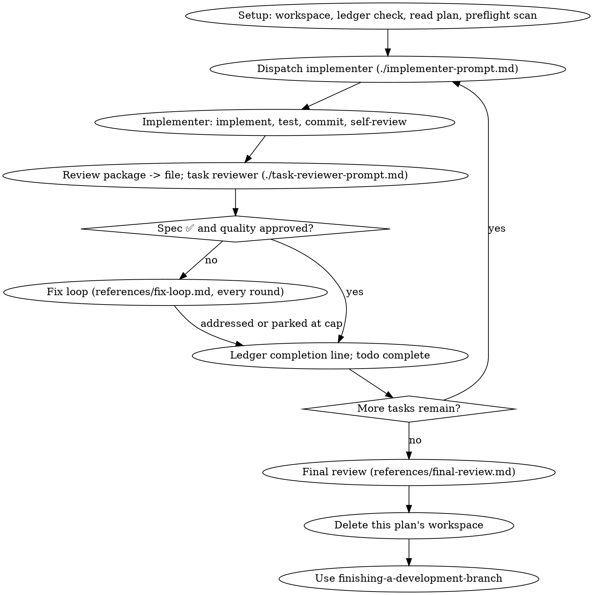

# Subagent-Driven Development

Execute a plan by dispatching a fresh implementer subagent per task, a task review (spec compliance + code quality) after each, and a broad whole-branch review at the end.

**Why subagents:** You delegate tasks to specialized agents with isolated context. Precisely crafted instructions and context keep them focused; they never inherit your session's history. This also preserves your own context for coordination work.

**Core principle:** Fresh subagent per task + task review (spec + quality) + broad final review = high quality, fast iteration

**Continuous execution:** Do not pause to check in between tasks. "Should I continue?" prompts and progress summaries waste your human partner's time — they asked you to execute the plan, so execute it.

**Rulings, not stalls.** A running plan does not wait on a human. Conflicts, ambiguities, plan defects, a cap you would have asked to exceed — decide them. The spec is the binding authority, the plan is its argument, and your judgment settles what neither answers. Record every decision in the ledger as `Ruling: <what you decided> — <why> — <what it costs if wrong>`, and keep going. A wrong ruling costs visible rework; a session parked on a question costs the whole day and buys nothing.

Four things stop you, and only these: an irreversible or destructive operation; a security-sensitive action; a side effect outside this workspace that norms say you ask about first (a merge, a push to a shared branch, a publish); and a plan so broken that every path forward is a guess. For those, stop and ask.

## When to Use

- Have an implementation plan with mostly independent tasks, and subagent capability? → this skill, in this session.
- Tasks tightly coupled (each shapes the next)? → manual execution or brainstorm first.
- No subagent capability, or your partner chose inline execution? → executing-plans.
- Never start on a main/master branch without your partner's explicit consent.

## The Process

## Setup

Conversation memory does not survive compaction. Controllers that lost their place have re-dispatched entire completed task sequences — the single most expensive failure observed. Track progress in a ledger file, not only in todos.

- **Each plan owns a workspace:** `<repo-root>/.agent/sdd/<plan-basename>/`, derived from the plan file's basename. It is git-ignored scratch, home to every artifact for THIS plan: the ledger, briefs, reports, review packages. Another plan's directory is never yours to read or write. `git clean -fdx` destroys it; if that happens, recover from `git log`.
- Check for this plan's ledger at `<workspace>/progress.md`. If one exists, read [references/resuming.md](references/resuming.md) before anything else: it says whose ledger it is and where to resume.
- Create the ledger with its identity as the first line: `# SDD ledger — plan: <plan file path>`. The commits it names exist in git even when your context no longer remembers creating them. After compaction, trust the ledger and `git log` over your own recollection.

Read the plan once, note its context and Global Constraints, and create a todo per task (the engine's todo tool). If the plan carries a `Spec:` pointer, read that too: the spec is the authority the plan argues from, and conflicts inside the plan resolve against it. A plan with no reachable spec gets a ledger note saying so — rulings made without one are provisional.

Before dispatching Task 1, read [references/preflight.md](references/preflight.md) and run the conflict scan it describes. Its table and rulings go in the ledger.

## Model Selection

Use the least powerful model that can handle each role. Mechanical implementation tasks (isolated functions, clear specs, 1-2 files): a fast, cheap model. Integration and judgment tasks (multi-file coordination, debugging): a standard model. Architecture, design, and the final whole-branch review: the most capable available model — dispatch that review on it explicitly, not the session default. Reviews otherwise scale to the diff's risk; scoped re-reviews of small fix diffs take a cheap-to-mid tier. Fix-loop escalation (rounds 4-5): a model at least one tier above the implementer that got stuck.

**Always specify the model explicitly when dispatching a subagent.** An omitted model inherits the session default — often the most capable and most expensive — which silently defeats this section. **Turn count beats token price:** the cheapest models routinely take 2-3× the turns on multi-step work. Use a mid-tier model as the floor for reviewers; use the cheapest tier when the brief contains the complete code to write (transcription plus testing).

## The Task Loop

**Small same-shape work:** when the plan lists several small edits of the same kind across files, read [references/batching.md](references/batching.md) before dispatching them.

Everything you paste into a dispatch prompt — and everything a subagent prints back — stays resident in your context for the rest of the session. Hand artifacts over as files. While you have local work — ledger updates, packaging the next review — keep working; child results arrive on their own.

### 1. Dispatch the implementer

Record BASE (`git rev-parse HEAD`) before dispatching — the review package and fix-round diffs need it.

- **Task brief:** extract the task's full text to `<workspace>/task-N-brief.md` and make the brief the single source of requirements. The dispatch itself contains: (1) one line on where this task fits; (2) the brief path, introduced as "read this first — it is your requirements"; (3) interfaces and decisions from earlier tasks that the brief cannot know; (4) your resolution of any ambiguity you noticed; (5) the report-file path and report contract. Exact values (numbers, magic strings, signatures, test cases) appear only in the brief. Never make a subagent read the whole plan file.
- **Report file:** name it after the brief (`task-N-brief.md` → `task-N-report.md`). The implementer writes the full report there and returns only status, commits, a one-line test summary, and concerns.
- A dispatch describes one task, not the session's history. Do not paste accumulated prior-task summaries into later dispatches — a fresh subagent needs its task, the interfaces it touches, and the global constraints. Nothing else.
- The dispatch carries the no-subagents contract (it is in the implementer template): the implementer never dispatches subagents — not helpers, and never a reviewer. Review arrives from you, after the report.
- If an earlier task parked a finding in the area this task touches, carry a pointer to that ledger entry in the dispatch.
- Record the implementer's agent identity from the dispatch result — fix-loop rounds 1-3 resume this agent.
- Never dispatch multiple implementation subagents in parallel (conflicts).

Template: [implementer-prompt.md](implementer-prompt.md)

### 2. Handle the report

**DONE:** write the review package to a file — commit list, `git diff --stat`, and `git diff -U10` for `BASE..HEAD`, redirected into the workspace as `task-N-diff.md`. BASE is the commit you recorded before dispatching — never `HEAD~1`, which silently drops all but the last commit of a multi-commit task. Then dispatch the task reviewer with the file path.

**Any other status** (DONE_WITH_CONCERNS, NEEDS_CONTEXT, BLOCKED): read [references/handling-reports.md](references/handling-reports.md) and follow it, every time you get one.

If the implementer asks questions — before starting or mid-task — answer clearly and completely, and don't rush it into implementation.

### 3. Review the task

Per-task reviews are task-scoped gates; the broad review happens once, at the final whole-branch review. Never skip the task review, and never accept a report missing either verdict — spec compliance AND task quality are both required. Implementer self-review never replaces the task review.

- **Reviewer inputs:** three file paths — the brief, the report, the review package — plus the global constraints that bind the task.
- The global-constraints block is the reviewer's attention lens. Copy the binding requirements verbatim from the plan's Global Constraints section or the spec: exact values, exact formats, and stated relationships between components ("same layout as X", "matches Y"). The reviewer's template already carries the process rules — the constraints block is for what THIS project's spec demands.
- Do not add open-ended directives ("check all uses", "run race tests if useful") without a concrete, task-specific reason. Do not ask the reviewer to re-run tests the implementer already ran — the report carries the test evidence.
- Do not pre-judge findings — never instruct a reviewer to ignore or not flag a specific issue. If you believe a finding would be a false positive, let the reviewer raise it and adjudicate it in the review loop. If the prompt you are writing contains "do not flag," "at most Minor," or "the plan chose" — stop: you are pre-judging.

If the reviewer reports "⚠️ Cannot verify from diff" items, read [references/cannot-verify.md](references/cannot-verify.md) before you mark the task complete.

Template: [task-reviewer-prompt.md](task-reviewer-prompt.md)

### 4. The fix loop

The loop triggers when the review reports spec ❌, any Critical or Important finding, or a ⚠️ item you confirmed as a real gap. When it triggers, read [references/fix-loop.md](references/fix-loop.md) and follow it. Read it again before every round, even if you read it earlier in this session: it holds the round cap, the breaker, and the ledger line each round writes, and your memory of it does not survive compaction.

### 5. Complete the task

When the review comes back clean — or every open finding is parked with a ruling at the cap — append the completion line to the ledger:

- `Task <N>: complete (commits <base7>..<head7>, review clean)`
- `Task <N>: complete (commits <base7>..<head7>, <K> parked)` after a tripped breaker

Then mark the todo complete and move on. Never move to the next task while the review has open Critical/Important issues that are neither fixed nor parked-with-ruling at the cap.

## Final Review

When every task is complete, read [references/final-review.md](references/final-review.md) and follow it. It covers the whole-branch review, its single fix wave, the rulings you must surface, and deleting this plan's workspace.

## Common Rationalizations

| Excuse | Reality |
|--------|---------|
| "Close enough on spec compliance" | Reviewer found spec gaps = not done. Fix or hit the cap and adjudicate — those are the only exits. |
| "I'll fix it myself, dispatching is overhead" | Controller fixes pollute your context and skip review. Resume the implementer. |
| "One more round will converge" | Past the cap, rounds don't converge — the failure is structural. Adjudicate and route. |
| "The fix was small, skip the re-review" | Unreviewed fixes are how regressions land. Every round ends with a scoped re-review. |
| "This finding is obviously wrong, I'll drop it" | You adjudicate only at the cap, and every ruling is a ledger entry. Silent discards are forbidden. |
| "Ledger bookkeeping is overhead" | The ledger is what survives compaction. Controllers without one have re-dispatched entire completed task sequences. |
| "The implementer spawned its own reviewer — free extra assurance" | It's a duplicate seat reviewing the same diff; the task review is the gate. A worker-spawned reviewer is a defect to flag, not rigor. |

## Integration

**Required workflow skills:** writing-plans (produce the plan, with a `Spec:` pointer when a spec exists), test-driven-development (implementers follow it), requesting-code-review (final whole-branch review), finishing-a-development-branch (integration decision).

**Subagents use:** the prompt templates above. Reviewers verify against the diff and test evidence, never against the implementer's summary.
